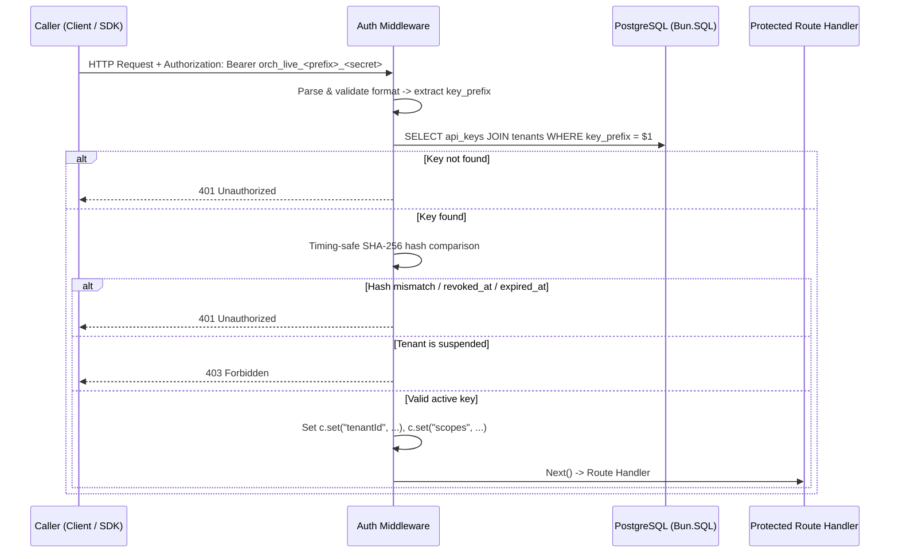
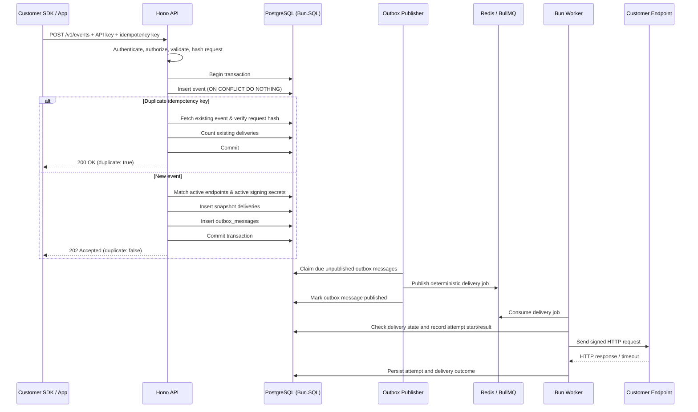

# Orchestrail Architecture

**Status:** Implementation architecture baseline. Verified components include Monorepo infrastructure, Docker PostgreSQL/Redis, Database package with Bun.SQL, Tenant provisioning, API key authentication, and Transactional Event Ingestion with Outbox.

## 1. Architecture goals

Orchestrail is a multi-tenant infrastructure platform for events, webhooks, and durable workflows. Its architecture prioritizes:

- Reliable ingestion independent of destination availability.
- At-least-once asynchronous webhook delivery.
- Tenant isolation at API, query, and database-constraint levels.
- Durable business state in PostgreSQL.
- Queue execution through BullMQ + Redis.
- Observable attempts, errors, retries, and replay history.
- Independent failure of the AI layer without breaking core platform capabilities.
- A modular monolith with separate runtime processes before considering microservices.

## 2. Tenant Provisioning & Authentication Architecture

### 1. Tenant Provisioning

Tenant registration is not a public HTTP endpoint. It is executed via administrative scripts or CLI (`apps/api/bin/provision-tenant.ts`) using an atomic transaction that creates the tenant and an initial privileged API key. The plaintext key is revealed once.

### 2. API Key Authentication Sequence



## 2.1 Architectural boundaries and vertical slices

We follow a feature-first modular architecture (vertical slice architecture) across all services:

| Layer / Directory  | Owns                                                                                   |
| ------------------ | -------------------------------------------------------------------------------------- |
| `common/`          | Shared technical infrastructure (error handling, HTTP utilities, shared middleware)    |
| `features/`        | Business capabilities (e.g. `health`, `events`, `endpoints`, `api-keys`, `deliveries`) |
| `config/`          | Application configuration and environment validation                                   |
| `packages/db/`     | Database infrastructure and schema                                                     |
| `packages/shared/` | Cross-application contracts and types                                                  |
| `packages/queue/`  | BullMQ infrastructure and job contracts                                                |

Rules:

- Application code is organized by feature rather than layer (no global `routes/`, `controllers/`, or `services/` folders).
- Cross-cutting technical capabilities live in `common/`.
- Application-specific configurations live in `config/` and are validated on process startup.

## 2.2 Event Ingestion Slice (`apps/api/src/features/events`)

The event ingestion slice is structured cleanly by responsibility:

- `events.routes.ts`: registers `POST /v1/events` and applies `requireScope("events:write")`.
- `events.handler.ts`: validates headers, payload size limit (256 KiB), and parses schema.
- `events.service.ts`: coordinates canonical request hashing, the PostgreSQL transaction, and endpoint matching.
- `events.repository.ts`: executes tenant-scoped database operations.
- `events.schema.ts`: Zod schema for event payload, event type regex, and idempotency key.
- `event-hash.ts`: canonical JSON stringifier and SHA-256 hash generator.

## 3. Event ingestion and outbox flow

The event endpoint must not call customer webhook URLs synchronously.



### Why the outbox exists

PostgreSQL and Redis do not share a transaction. If the API commits an event and then Redis is unavailable, directly publishing to BullMQ can fail after the event has already been stored. The outbox records the intention to publish in the same PostgreSQL transaction as the event and delivery rows.

The publisher later retries publication. A crash after publishing to Redis but before marking the outbox row published can cause duplicate publication. Therefore:

- Outbox publication is at least once.
- Queue jobs use stable identifiers (`delivery_id`, `tenant_id`, `message_id`).
- Worker processing must check PostgreSQL state and be idempotent.
- BullMQ job-ID deduplication is an optimization, not the only correctness guarantee.

## 4. BullMQ and Redis responsibilities

BullMQ + Redis provide queue infrastructure:

- Queue producers and consumers.
- Worker concurrency.
- Delayed jobs.
- Configured retry attempts and backoff.
- Job lifecycle management.
- Stalled-job detection and recovery.

Orchestrail owns application semantics:

- Whether a delivery is retryable.
- Retry policy and maximum attempts.
- Delivery state transitions.
- Attempt history and receiver response metadata.
- Tenant-specific routing and authorization.
- Dead-letter business status and replay behavior.
- Reconciliation between queue activity and authoritative database state.

Do not build a second queue inside PostgreSQL. PostgreSQL `FOR UPDATE SKIP LOCKED` may be useful for claiming outbox rows, but BullMQ is the selected delivery-job queue.

## 5. Delivery lifecycle

A proposed business lifecycle is:

```text
pending -> queued -> processing -> succeeded
                         |
                         +-> retrying -> queued/processing
                         |
                         +-> dead_lettered

pending/queued -> cancelled (where cancellation is safe and supported)
```

The exact transitions must be implemented as guarded database updates. The database status is the authoritative business status. BullMQ's job state is operational queue state and should not be presented as a replacement for the delivery record.

Use BullMQ attempts/backoff/delayed-job features where appropriate. Application code classifies HTTP/network outcomes, persists attempt records and business status, and ensures final state is consistent. Do not create a separate retry scheduler that conflicts with BullMQ. A reconciliation process may be added for explicitly defined inconsistencies, but it must not blindly enqueue duplicate work.

## 6. Worker safety and delivery guarantees

The initial delivery guarantee is **at least once**. Exactly-once HTTP delivery cannot be guaranteed by Orchestrail because the receiver may process a request even when the sender times out or crashes before recording success.

Important scenario:

1. Worker sends the webhook.
2. Customer endpoint processes it successfully.
3. Worker crashes before persisting success.
4. Queue retry or recovery sends the same delivery again.

Mitigations:

- Include a stable `delivery_id` in the webhook envelope and headers.
- Document that customers should deduplicate by delivery ID.
- Make database transitions and attempt numbering concurrency-safe.
- Check whether a delivery is already terminal before sending again.
- Keep each attempt as an append-only history record.

All outbound requests require timeouts, response-size limits, safe error classification, and structured logs with correlation IDs.

## 7. Multi-tenancy and security

- Every tenant-owned table contains `tenant_id` unless there is a documented reason otherwise.
- Resolve the tenant from the authenticated API key, never from an untrusted body field.
- Scope every read, update, delete, replay, and subscription lookup by tenant.
- Use tenant-aware foreign keys/composite constraints where useful.
- Store only a cryptographic hash of high-entropy API key secrets; reveal the plaintext once.
- Encrypt webhook signing secrets at rest because workers must retrieve them.
- Rotate signing secrets without losing the ability to verify requests during an explicitly defined transition period if overlap is supported.
- Verify webhook signatures over the exact raw request body; validate timestamps and compare MACs in constant time.
- Protect outbound webhook requests against SSRF: restrict loopback, private, link-local, and metadata destinations; validate DNS results; consider DNS rebinding; and define redirect behavior explicitly.
- Avoid logging secrets or unrestricted customer payloads.

## 8. Database ownership

PostgreSQL stores tenants, API key metadata, events, endpoints, subscriptions, deliveries, attempts, outbox messages, and initial rate-limit counters. See `DATABASE.md` for the schema.

The database is authoritative for business state. Redis loss must not erase event or delivery history. After Redis recovery, unpublished outbox messages can be republished and any explicitly designed reconciliation process can repair queue/database discrepancies.

## 9. Future workflow architecture

The workflow engine is a later phase. Its core state machine, workflow versions, execution records, step state, step results, timers, and compensation history will be stored in PostgreSQL.

BullMQ will dispatch runnable workflow steps and timers. It will not own the only copy of workflow progress. The engine must handle duplicate job delivery, worker crashes, step idempotency, retries, and saga compensation.

## 10. AI architecture boundary

The AI service will be introduced after core event and delivery reliability is established. It will retrieve event, delivery, workflow, and log data through explicit tenant-scoped interfaces. It will implement advanced RAG and later GraphRAG, but it must not sit synchronously in the critical event-ingestion or webhook-delivery path.

AI requests should have independent timeouts, budgets, and observability. An AI outage must not prevent customers from sending events or receiving webhooks.

## 11. Key architectural trade-offs to document with measurements

- PostgreSQL transaction and index overhead versus ingestion throughput.
- Outbox publisher batch size and polling interval versus publication latency.
- BullMQ concurrency versus receiver limits and database connection pressure.
- Retry/backoff policy versus delivery latency and queue retention.
- Payload/response retention versus storage cost and diagnostic value.
- Rate limiting in PostgreSQL versus a later Redis-backed limiter.
- Single shared PostgreSQL database versus future workload isolation.
