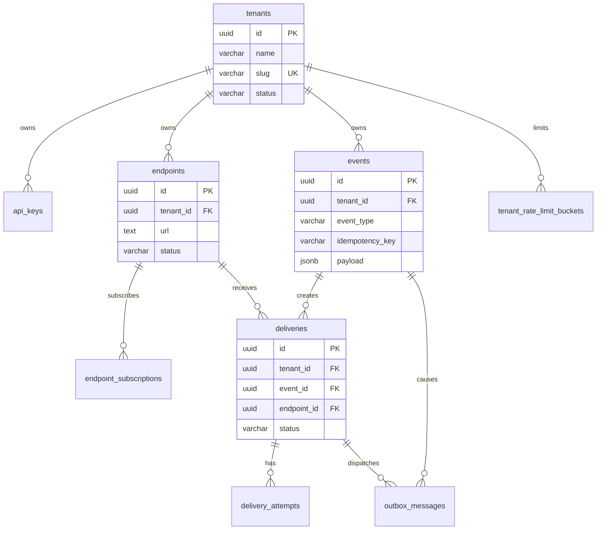

# Orchestrail Database Design

**Status:** Proposed initial schema. Field names and constraints should be reviewed before the first migration. This document does not mean migrations already exist.

## 1. Database principles

- PostgreSQL is the source of truth for business state.
- Use UUID primary keys unless a documented reason requires another key type.
- Use `timestamptz` for instants and store timestamps in UTC.
- Use `jsonb` for event payloads and flexible queue/outbox payload data where appropriate.
- Put `tenant_id` on tenant-owned records.
- Enforce tenant isolation in application queries and, where practical, with tenant-aware composite foreign keys.
- Use database constraints for invariants that must hold under concurrent requests.
- Create and evolve the schema through Drizzle migrations.
- Keep delivery attempts and replay history; do not overwrite historical facts.
- Add indexes based on real query patterns and verify them with query plans.

## 2. Relationship overview

The diagram is conceptual. Define actual foreign keys and composite constraints explicitly in Drizzle migrations.

## 3. Proposed tables

### 3.1 `tenants`

Represents a customer organization.

| Field                         | Suggested PostgreSQL type | Rules / purpose                                        |
| ----------------------------- | ------------------------- | ------------------------------------------------------ |
| `id`                          | `uuid`                    | Primary key; generated UUID.                           |
| `name`                        | `varchar(200)`            | Required organization name.                            |
| `slug`                        | `varchar(100)`            | Required, unique tenant identifier.                    |
| `status`                      | `varchar(30)`             | Required; proposed values `active`, `suspended`.       |
| `event_rate_limit_per_minute` | `integer`                 | Required positive limit; default policy to be decided. |
| `created_at`                  | `timestamptz`             | Required, default current time.                        |
| `updated_at`                  | `timestamptz`             | Required, updated on mutation.                         |

Constraints/indexes: primary key on `id`; unique index on `slug`; check positive rate limit.

### 3.2 `api_keys`

Stores API-key metadata, not plaintext secrets.

| Field          | Suggested PostgreSQL type | Rules / purpose                              |
| -------------- | ------------------------- | -------------------------------------------- |
| `id`           | `uuid`                    | Primary key.                                 |
| `tenant_id`    | `uuid`                    | Required FK to tenant.                       |
| `name`         | `varchar(150)`            | Human-readable key name.                     |
| `key_prefix`   | `varchar(32)`             | Non-secret prefix for identification.        |
| `key_hash`     | `text`                    | Required unique hash of high-entropy secret. |
| `scopes`       | `text[]`                  | Required allowed scopes.                     |
| `last_used_at` | `timestamptz`             | Nullable last usage.                         |
| `expires_at`   | `timestamptz`             | Nullable expiry.                             |
| `revoked_at`   | `timestamptz`             | Nullable revocation timestamp.               |
| `created_at`   | `timestamptz`             | Required creation timestamp.                 |

Constraints/indexes: unique `key_hash`; index `(tenant_id, created_at)`; consider index on `key_prefix` for lookup. API keys must be generated with sufficient entropy. Return plaintext once, then never again.

### 3.3 `events`

The central event record.

| Field             | Suggested PostgreSQL type | Rules / purpose                                          |
| ----------------- | ------------------------- | -------------------------------------------------------- |
| `id`              | `uuid`                    | Primary key.                                             |
| `tenant_id`       | `uuid`                    | Required tenant FK.                                      |
| `event_type`      | `varchar(200)`            | Required, e.g. `payment.completed`.                      |
| `idempotency_key` | `varchar(255)`            | Required tenant-scoped key.                              |
| `request_hash`    | `text`                    | Required stable hash of accepted semantic request.       |
| `payload`         | `jsonb`                   | Required event data/envelope as defined by API contract. |
| `occurred_at`     | `timestamptz`             | Nullable source event time.                              |
| `created_at`      | `timestamptz`             | Required platform receipt/creation time.                 |

Constraints/indexes:

- Unique `(tenant_id, idempotency_key)`.
- Index `(tenant_id, created_at DESC)` for event feed.
- Index `(tenant_id, event_type, created_at DESC)` when event-type filtering is required.
- Enforce a maximum payload size at the API boundary; JSONB is not a substitute for payload limits.

If `occurred_at` is absent, `created_at` remains the platform timestamp. Do not conflate customer event time and ingestion time.

### 3.4 `endpoints`

Stores customer webhook destinations.

| Field                       | Suggested PostgreSQL type | Rules / purpose                                        |
| --------------------------- | ------------------------- | ------------------------------------------------------ |
| `id`                        | `uuid`                    | Primary key.                                           |
| `tenant_id`                 | `uuid`                    | Required tenant FK.                                    |
| `url`                       | `text`                    | Required validated destination URL.                    |
| `description`               | `varchar(255)`            | Optional display description.                          |
| `status`                    | `varchar(30)`             | Required; proposed `active`, `disabled`.               |
| `signing_secret_ciphertext` | `text`                    | Encrypted signing secret.                              |
| `signing_secret_nonce`      | `text`                    | Encryption nonce/IV as required by chosen AEAD scheme. |
| `secret_key_version`        | `integer`                 | Encryption-key version for rotation.                   |
| `created_at`                | `timestamptz`             | Required creation timestamp.                           |
| `updated_at`                | `timestamptz`             | Required update timestamp.                             |

Constraints/indexes: index `(tenant_id, created_at DESC)` and `(tenant_id, status)`. Consider a tenant-aware unique constraint on `(tenant_id, id)` to support composite foreign keys.

The application must encrypt secrets with a well-defined authenticated-encryption scheme and keep the master encryption key outside the database. Do not invent cryptographic storage formats ad hoc.

### 3.5 `endpoint_subscriptions`

Defines event types subscribed to by each endpoint.

| Field         | Suggested PostgreSQL type | Rules / purpose           |
| ------------- | ------------------------- | ------------------------- |
| `id`          | `uuid`                    | Primary key.              |
| `tenant_id`   | `uuid`                    | Required tenant FK.       |
| `endpoint_id` | `uuid`                    | Required endpoint FK.     |
| `event_type`  | `varchar(200)`            | Required subscribed type. |
| `created_at`  | `timestamptz`             | Required creation time.   |

Constraints/indexes:

- Unique `(tenant_id, endpoint_id, event_type)`.
- Index `(tenant_id, event_type)` for routing event types to subscribed endpoints.
- Use a composite FK `(tenant_id, endpoint_id)` to ensure the endpoint belongs to the same tenant, if the parent key is modeled accordingly.

### 3.6 `deliveries`

A business record for one event-to-endpoint delivery. A replay creates a new row.

| Field                   | Suggested PostgreSQL type | Rules / purpose                                                                                       |
| ----------------------- | ------------------------- | ----------------------------------------------------------------------------------------------------- |
| `id`                    | `uuid`                    | Primary key and stable customer-visible delivery ID.                                                  |
| `tenant_id`             | `uuid`                    | Required tenant FK.                                                                                   |
| `event_id`              | `uuid`                    | Required event FK.                                                                                    |
| `endpoint_id`           | `uuid`                    | Required endpoint FK.                                                                                 |
| `status`                | `varchar(30)`             | Proposed `pending`, `queued`, `processing`, `retrying`, `succeeded`, `dead_lettered`, `cancelled`.    |
| `attempt_count`         | `integer`                 | Required, default zero. Define whether this means started or completed attempts and use consistently. |
| `max_attempts`          | `integer`                 | Required configured maximum.                                                                          |
| `next_attempt_at`       | `timestamptz`             | Nullable scheduled retry/eligibility time.                                                            |
| `queue_job_id`          | `varchar(200)`            | Nullable BullMQ job identifier for diagnostics/correlation.                                           |
| `last_http_status`      | `integer`                 | Nullable last receiver status.                                                                        |
| `last_error`            | `text`                    | Nullable bounded/sanitized last error summary.                                                        |
| `replay_of_delivery_id` | `uuid`                    | Nullable self-FK to original delivery.                                                                |
| `delivery_sequence`     | `integer`                 | Required sequence; original delivery can use zero, subsequent replay sequence increases.              |
| `delivered_at`          | `timestamptz`             | Nullable successful delivery time.                                                                    |
| `created_at`            | `timestamptz`             | Required creation time.                                                                               |
| `updated_at`            | `timestamptz`             | Required update time.                                                                                 |

Constraints/indexes:

- Unique `(tenant_id, event_id, endpoint_id, delivery_sequence)` if this sequence model is adopted.
- Index for tenant delivery history `(tenant_id, created_at DESC)`.
- Index `(tenant_id, status, created_at DESC)` for filtered history.
- Index on `(status, next_attempt_at)` only if a real reconciliation/due-work query uses it; BullMQ is the primary delivery queue.
- Index `lease_expires_at` only if an application-level lease design is deliberately added. Do not copy the old PostgreSQL queue design into this BullMQ architecture without a reason.
- Composite tenant-aware FKs to event and endpoint prevent cross-tenant references.

The exact replay sequence allocation strategy must be concurrency-safe. An alternative is to rely on a new UUID per replay and store only the original link; choose one model before migration.

### 3.7 `delivery_attempts`

Append-only history of HTTP attempts.

| Field                   | Suggested PostgreSQL type | Rules / purpose                                         |
| ----------------------- | ------------------------- | ------------------------------------------------------- |
| `id`                    | `uuid`                    | Primary key.                                            |
| `tenant_id`             | `uuid`                    | Required tenant FK.                                     |
| `delivery_id`           | `uuid`                    | Required delivery FK.                                   |
| `attempt_number`        | `integer`                 | Required 1-based attempt number.                        |
| `status`                | `varchar(30)`             | Proposed `succeeded`, `failed`, `timed_out`, `aborted`. |
| `http_status_code`      | `integer`                 | Nullable when no HTTP response exists.                  |
| `response_body_excerpt` | `text`                    | Nullable bounded and redacted excerpt.                  |
| `error_code`            | `varchar(100)`            | Nullable normalized failure code.                       |
| `error_message`         | `text`                    | Nullable sanitized summary.                             |
| `duration_ms`           | `integer`                 | Nullable non-negative duration.                         |
| `started_at`            | `timestamptz`             | Required start time.                                    |
| `completed_at`          | `timestamptz`             | Nullable completion time.                               |

Constraints/indexes:

- Unique `(delivery_id, attempt_number)`.
- Index `(tenant_id, delivery_id, attempt_number)`.
- Ensure the parent delivery belongs to the same tenant through a composite FK where practical.
- Do not store unbounded response bodies or secrets.

### 3.8 `outbox_messages`

Durable intent to publish work to BullMQ.

| Field              | Suggested PostgreSQL type | Rules / purpose                                                                          |
| ------------------ | ------------------------- | ---------------------------------------------------------------------------------------- |
| `id`               | `uuid`                    | Primary key.                                                                             |
| `tenant_id`        | `uuid`                    | Required tenant FK.                                                                      |
| `event_id`         | `uuid`                    | Nullable/required according to message type; linked event for event-originated dispatch. |
| `delivery_id`      | `uuid`                    | Nullable/required according to message type; delivery to dispatch.                       |
| `message_type`     | `varchar(100)`            | Required, e.g. `webhook.delivery.dispatch`.                                              |
| `dedupe_key`       | `varchar(255)`            | Required unique application-level publication key.                                       |
| `payload`          | `jsonb`                   | Required minimal job payload; avoid duplicating large event data unnecessarily.          |
| `status`           | `varchar(30)`             | Proposed `pending`, `publishing`, `published`.                                           |
| `attempts`         | `integer`                 | Required publication-attempt counter.                                                    |
| `next_attempt_at`  | `timestamptz`             | Required next publication eligibility.                                                   |
| `locked_by`        | `varchar(150)`            | Nullable publisher instance identifier.                                                  |
| `locked_at`        | `timestamptz`             | Nullable claim time.                                                                     |
| `lease_expires_at` | `timestamptz`             | Nullable publisher claim expiry for crash recovery.                                      |
| `last_error`       | `text`                    | Nullable sanitized publication error.                                                    |
| `published_at`     | `timestamptz`             | Nullable successful enqueue time.                                                        |
| `created_at`       | `timestamptz`             | Required creation time.                                                                  |

Constraints/indexes:

- Unique `dedupe_key`.
- Index `(status, next_attempt_at)` for publisher polling.
- Index on `lease_expires_at` for expired publisher-claim recovery.
- Use a short database transaction to claim rows, publish outside the transaction, then mark publication. Do not keep a PostgreSQL transaction open during Redis network calls.

The publisher can use `FOR UPDATE SKIP LOCKED` or an atomic claim/update pattern to coordinate multiple publisher instances. This is for outbox publication, not a replacement for BullMQ's delivery queue.

### 3.9 `tenant_rate_limit_buckets`

Initial shared fixed-window rate-limit counters in PostgreSQL.

| Field           | Suggested PostgreSQL type | Rules / purpose              |
| --------------- | ------------------------- | ---------------------------- |
| `tenant_id`     | `uuid`                    | Required tenant FK.          |
| `window_start`  | `timestamptz`             | Required fixed-window start. |
| `request_count` | `integer`                 | Required non-negative count. |
| `updated_at`    | `timestamptz`             | Required last update.        |

Primary key `(tenant_id, window_start)`. Use an atomic upsert/increment so multiple API instances cannot lose increments. Define a retention cleanup policy. PostgreSQL-backed limiting is simple and shared across API instances but adds write load; benchmark it. Redis is already present for BullMQ, but using it for rate limiting is a separate design decision.

## 4. Transaction boundaries

### Event acceptance transaction

One transaction should:

1. Insert the event (or resolve an idempotent duplicate safely).
2. Resolve the active subscriptions for the event type.
3. Insert one original delivery per matching endpoint.
4. Insert the corresponding outbox message(s).
5. Commit all rows together.

A duplicate event request must not create additional original deliveries or outbox messages.

### Outbox publication

1. Claim a batch of due pending or expired-lease messages in a short transaction.
2. Commit the claim.
3. Publish corresponding BullMQ jobs outside the transaction.
4. Mark rows published after successful enqueue.
5. If the publisher crashes after enqueue but before marking, the message may be published again; consumer-side idempotency must make this safe.

### Delivery attempt

Persist attempt start/result and guarded delivery state changes. Decide how to handle a crash between the external HTTP side effect and database completion; the system must accept at-least-once delivery and preserve enough state for safe retry.

## 5. Index and constraint strategy

Create indexes for demonstrated access paths, not every conceivable field. At minimum, evaluate:

- `tenants(slug)` unique.
- `api_keys(key_hash)` unique and `api_keys(tenant_id, created_at)`.
- `events(tenant_id, idempotency_key)` unique and `events(tenant_id, created_at DESC)`.
- `endpoint_subscriptions(tenant_id, endpoint_id, event_type)` unique and `endpoint_subscriptions(tenant_id, event_type)`.
- `deliveries(tenant_id, created_at DESC)` and `deliveries(tenant_id, status, created_at DESC)`.
- `delivery_attempts(delivery_id, attempt_number)` unique.
- `outbox_messages(dedupe_key)` unique and `outbox_messages(status, next_attempt_at)`.
- `tenant_rate_limit_buckets(tenant_id, window_start)` primary key.

Use `EXPLAIN (ANALYZE, BUFFERS)` against representative data before declaring an index useful. Be aware that indexes increase write cost and storage.

## 6. Data lifecycle and retention

Define policies before production:

- Event payload retention and deletion/export requirements.
- Delivery and attempt history retention.
- Outbox cleanup/archive after successful publication.
- Rate-limit bucket cleanup.
- Payload and response-excerpt size limits.
- Tenant deletion and referential integrity behavior.

Do not physically delete endpoint or delivery history merely because a customer disables an endpoint. Start with soft-disable semantics and establish explicit retention/deletion workflows later.
