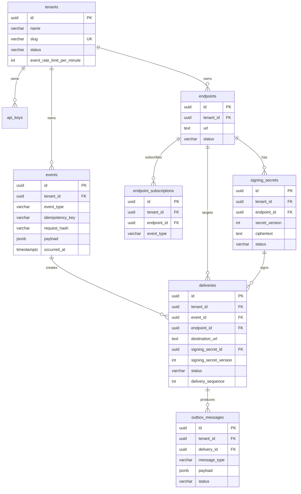

# Orchestrail Database Design & Implementation

## 1. Package Architecture (`@orchestrail/db`)

Database access is encapsulated in `packages/db` and shared across consuming applications:

- **Driver**: Native `Bun.SQL` (`new SQL(...)`) with built-in connection pooling (`drizzle-orm/bun-sql`).
- **ORM / Query Builder**: `drizzle-orm`.
- **Migrations Tool**: `drizzle-kit` targeting `packages/db/drizzle`.

### Connection Pool Strategy (Bun.SQL)

Each process (`apps/api`, `apps/worker`) instantiates its own isolated connection pool using `createDatabaseClient(config)`:

```ts
import { createDatabaseClient } from "@orchestrail/db";

const dbClient = createDatabaseClient({
  connectionString: process.env.DATABASE_URL,
  max: 20,
  idleTimeout: 30,
  connectTimeout: 5,
});
```

### Migration Workflow

1. **Generate**: `bun --filter @orchestrail/db db:generate` (reads `packages/db/src/schema` and outputs to `packages/db/drizzle`).
2. **Review**: Inspect generated SQL files and metadata.
3. **Migrate**: `bun --filter @orchestrail/db db:migrate` (applies pending migrations recorded in `drizzle.__drizzle_migrations`).

---

## 2. Active Schemas & Relationships



---

## 3. Implemented Database Tables

### 3.1 `tenants`

Represents an isolated customer organization.

- Unique index: `slug`
- Check constraint: `event_rate_limit_per_minute > 0`

### 3.2 `api_keys`

API key credentials with constant-time prefix-indexed SHA-256 verification.

- Unique: `key_prefix`, `key_hash`
- Indexes: `(tenant_id, created_at)`

### 3.3 `events`

Immutable record of ingested customer events.

- Unique: `(tenant_id, idempotency_key)`
- Unique: `(tenant_id, id)`
- Indexes: `(tenant_id, created_at)`, `(tenant_id, event_type, created_at)`

### 3.4 `endpoints`

Customer webhook destination URLs.

- Unique: `(tenant_id, id)`
- Indexes: `(tenant_id, status)`, `(tenant_id, created_at)`

### 3.5 `signing_secrets`

Webhook HMAC signing secrets encrypted at rest.

- Unique: `(tenant_id, id)`
- Indexes: `(endpoint_id, status)`

### 3.6 `endpoint_subscriptions`

Subscribed event types per webhook endpoint.

- Unique: `(tenant_id, endpoint_id, event_type)`
- Indexes: `(tenant_id, event_type)`

### 3.7 `deliveries`

Snapshot of an event-to-endpoint delivery intent.

- Snapshots `destination_url`, `signing_secret_id`, and `signing_secret_version`.
- Unique: `(tenant_id, event_id, endpoint_id, delivery_sequence)`
- Indexes: `(tenant_id, created_at)`, `(tenant_id, status, created_at)`

### 3.8 `outbox_messages`

Transactional outbox records connecting PostgreSQL business state to future BullMQ queue dispatch.

- Unique: `(delivery_id, message_type)`
- Indexes: `(status, next_attempt_at)`, `(tenant_id, created_at)`

---

## 4. Ingestion Transaction Boundary

The event ingestion API executes within a single PostgreSQL transaction (`db.transaction`):

1. Insert event using `ON CONFLICT (tenant_id, idempotency_key) DO NOTHING`.
2. On conflict: lookup existing event, compare `request_hash`, count existing deliveries, commit.
3. For new events: query matching active endpoints (`endpoints.status = 'active'`) with subscriptions matching `event_type`.
4. Validate that all active matching endpoints have an active signing secret; fail and rollback transaction on data-integrity error.
5. Insert snapshot `deliveries` rows.
6. Insert `outbox_messages` rows (`webhook.delivery.requested`).
7. Commit all records atomically. No external network or Redis calls occur inside this transaction.
